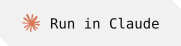
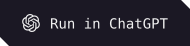
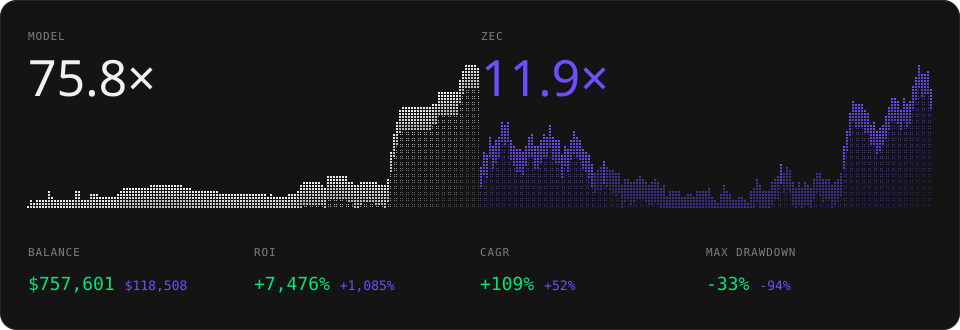
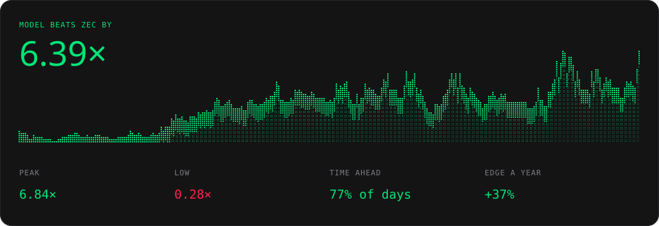
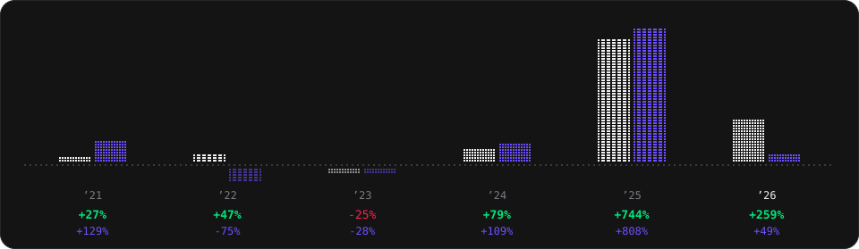
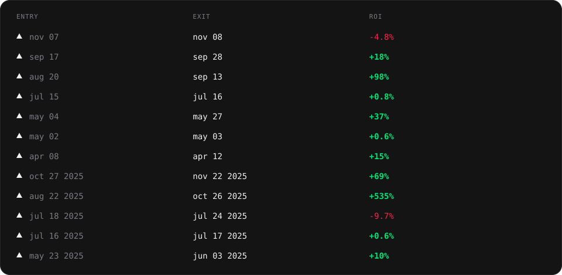

<h1 align="center">ZEC 3020 Breakout</h1>

<p align="center">An open-source trading model for Zcash that runs in Claude or ChatGPT.</p>

<p align="center">
  <a href="https://tickerdb.com/go/claude/zec-3020-breakout"></a>
  &nbsp;
  <a href="https://tickerdb.com/go/chatgpt/zec-3020-breakout"></a>
</p>

<p align="center">Click a button above, or paste this into Claude in your browser (in ChatGPT, use the button above):</p>

```
Read https://tickerdb.com/run/zec-3020-breakout and follow its steps. Once it's set up, schedule a daily check every day after 06:00 UTC that reads my model link and tells me only if the model bought or sold something.
```

<p align="center">No signup first and no API key to paste: the assistant gives you one link to approve (a free TickerDB account is created there if you are new), then shows you the model's record and checks it for you every day. Each check uses 5 TickerDB credits; the Free plan's 250 credits a month cover one daily check.</p>

<p align="center">
  Data: <a href="https://tickerdb.com">TickerDB</a>. Live record since activation: <a href="https://tickerdb.com/model/zec-3020-breakout">tickerdb.com/model/zec-3020-breakout</a>
</p>

<p align="center">
  
</p>

ZEC 3020 Breakout returned +7,476% over the backtest, outperforming ZEC's +1,085% and ending 6.4× its result.

## Stats

<p align="center">
  
</p>

| | Model | ZEC |
|---|---:|---:|
| Balance from $10,000 | $757,601 | $118,508 |
| ROI | +7,476% | +1,085% |
| CAGR | +109% | +52% |
| Max drawdown | -33% | -94% |

From Jan 6, 2021 to Nov 20, 2026, valued at every daily close, after a 0.1% cost each way. ZEC is Zcash bought at the Jan 6, 2021 close and held.

ZEC 3020 Breakout grew faster than ZEC (+109% vs +52% a year), with a shallower worst fall (−33% vs −94%).

## Edge

<p align="center">
  
</p>

The model's balance over ZEC's, day by day: above 1× it was ahead.

| | |
|---|---:|
| Model beats ZEC by | 6.39× |
| Peak | 6.84× (Mar 7, 2026) |
| Low | 0.28× (May 12, 2021) |
| Time ahead | 77% of days |
| Edge a year | +37% |

ZEC 3020 Breakout beat ZEC by 6.4× and was ahead 77% of the time.

## Yearly ROI

<p align="center">
  
</p>

| Year | Model | ZEC |
|---|---:|---:|
| 2026 | +259% | +49% |
| 2025 | +744% | +808% |
| 2024 | +79% | +109% |
| 2023 | -25% | -28% |
| 2022 | +47% | -75% |
| 2021 | +27% | +129% |

The backtest starts on Jan 6, 2021 and ends on Nov 20, 2026, so 2021 and 2026 are part years. ZEC 3020 Breakout beat ZEC in 3 of 6 years; its best year was 2025 at +744%.

## Trades

<p align="center">
  
</p>

The 12 most recent; all 51 are in [`results/trades.csv`](results/trades.csv). Returns are after the 0.1% cost each way. ZEC 3020 Breakout closed 51 trades: 61% won, and the average trade returned +17%.

## Rules

1. **Buy** when ZEC closes at its highest close of the last 30 days, unless the day's volume is low.
2. **Sell** when ZEC closes below its 20-day SMA.
3. **Also sell** when the day's volume is low: under 70% of its average.
4. After a sale, **wait in cash** for the next 30-day closing high.
5. Signals are checked once a day at the close (00:00 UTC) and filled at the next open. Long or cash only, with no leverage and no shorts.

The parameters are at the top of [`model.py`](model.py).

## Run it yourself

With Claude Code, Codex, Cursor or another agent that runs code on your computer, paste this to clone the model and run it there on a schedule:

```
Clone github.com/tickerdb/zec-3020-breakout and follow its README:
set up TickerDB using tickerdb.com/setup, then schedule run.py to run
every day at 04:30 UTC and tell me when it makes a trade.
```

## How the results are made

The figures above are the model's published record, the same one [its page](https://tickerdb.com/model/zec-3020-breakout) shows: TickerDB runs these rules on its point-in-time data, marks the book at every daily close and publishes the result. [`readme.py`](readme.py) writes this README, its charts and `results/` from that record, and [`backtest.py`](backtest.py) replays the rules from the TickerDB API on its own and must make exactly the record's 51 trades, at the same prices.

```bash
export TICKERDB_API_KEY=tdb_...        # https://tickerdb.com/setup
python backtest.py                     # replays the rules on ZECUSD daily since 2020 (about 90 credits)
python backtest.py --offline           # reruns the replay on the cached data/zecusd_daily.csv
python readme.py                       # fetches the published record and rewrites the README, charts and results/
python readme.py --check               # fails if anything here differs from the record, or the replay's trades do
python run.py                          # today's decision
python -m unittest discover -s tests   # offline tests of the record
```

The replay needs a TickerDB plan with daily history back to 2020 (Pro). No dependencies beyond Python 3.10+.

The first `python run.py` starts from what the model holds now: it reads the model's newest book (`/v1/models/zec-3020-breakout/holdings`, on every plan, 1 credit), prints each position's side, entry date and price, and keeps it in `state.json`. Later runs carry it on from there.

Point in time: each decision uses only data up to that day's close, and the order fills at the next daily open. The 20-day SMA is TickerDB's `trend_ma20_price` and the volume zone its `volume_ratio_zone` band (`low` and `extremely_low` are days under 70% of average volume); the 30-day high is taken from the daily closes. A position takes the whole balance at the open it fills.

## Caveats

- **In-sample.** The rule and its parameters were chosen on the same 2021–2026 history they're tested on, so expect live results to be weaker.
- **One trade.** Most of the return comes from one trade, August to November 2025. Without those weeks the backtest makes about 42% a year.
- **Short history.** TickerDB's Zcash bars start in December 2020, so the backtest covers under six years.
- **Costs.** 0.1% each way, with no extra slippage. Zcash traded thinly on Coinbase in 2023 to 2025, so large orders would have moved the price.
- **Prices.** Coinbase daily ZEC-USD bars from TickerDB, on UTC days.
- **Point in time.** Each decision sees only data up to that day's close.
- **Fill timing.** The backtest fills at 00:00 UTC; live, the data arrives a little later, so live fills come after that.
- **Weekends.** Crypto volume is usually lower at weekends, so the low-volume rule sells more often on Saturdays.
- Not investment advice. A backtest shows how a model would have done in the past; it doesn’t predict future results.

## License

MIT. The fonts embedded in the README images (Oxanium, Inter, JetBrains Mono, in `assets/fonts/`) are under the SIL Open Font License 1.1.
